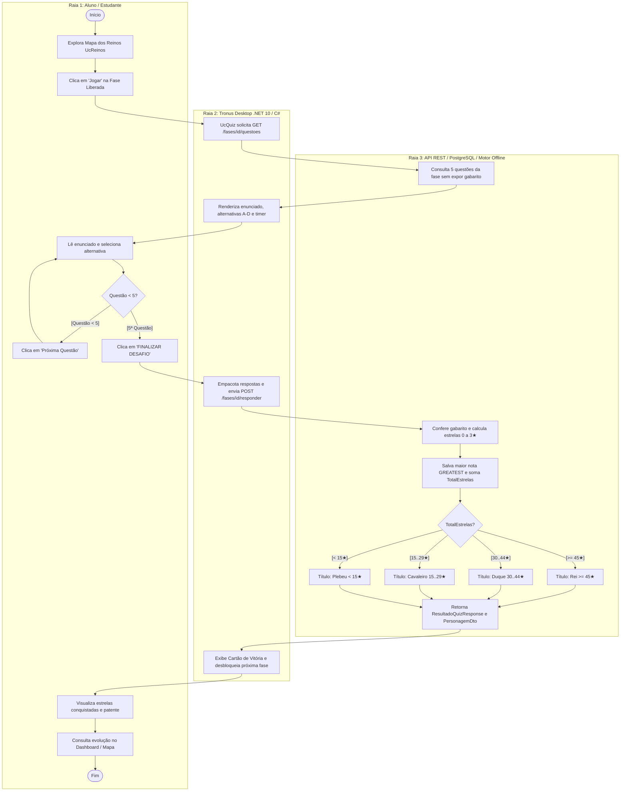
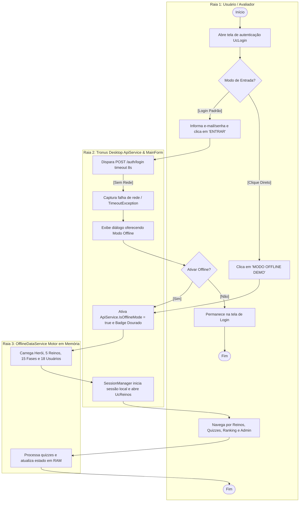
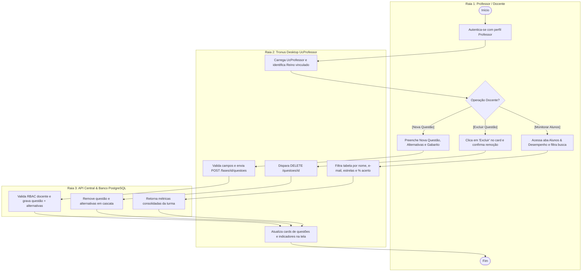
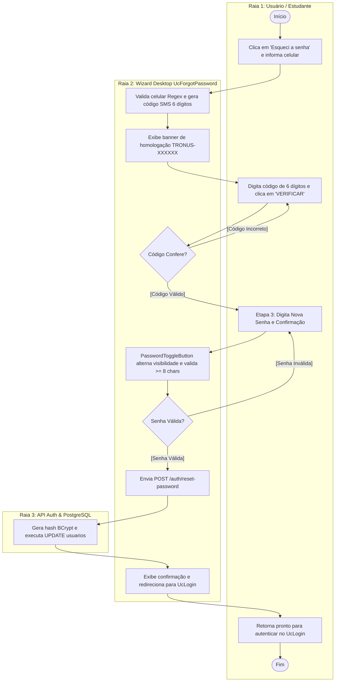
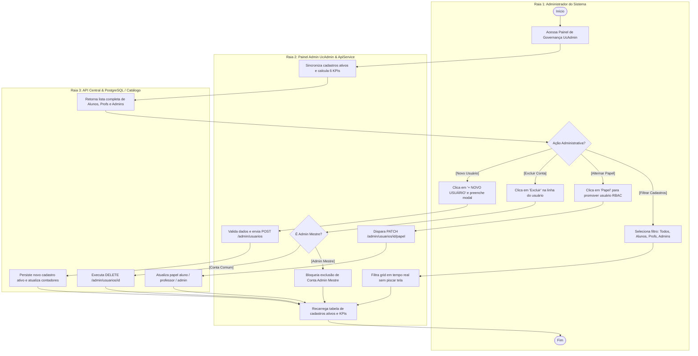
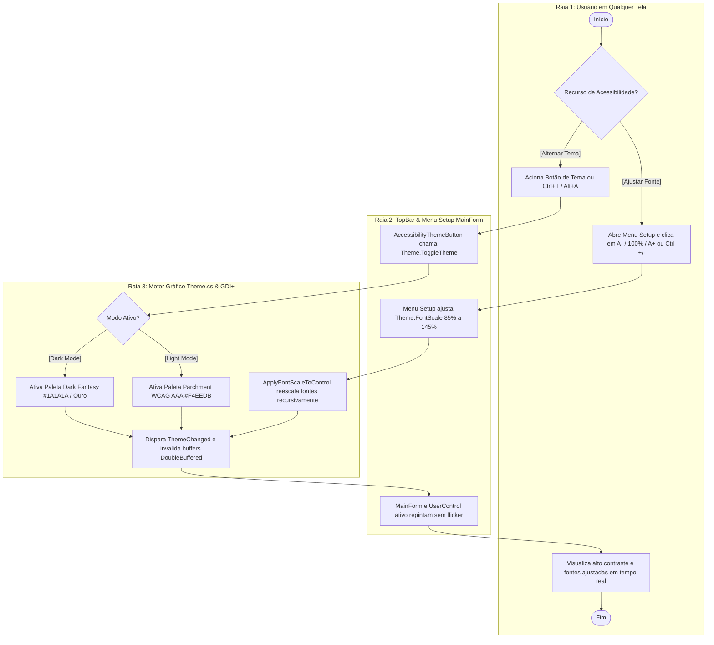

# 🔄 Diagrama de Atividades (UML) — Tronus Desktop

**Projeto Integrado Multidisciplinar (PIM III) — UNIP 2026**  
**Curso:** Superior de Tecnologia em Análise e Desenvolvimento de Sistemas (ADS)  
**Disciplina de Referência:** Engenharia de Software Ágil Aplicada  
**Plataforma de Aplicação:** Tronus Desktop (.NET 10 / C# Windows Forms)  
**Arquivos Modelados (`.asta` e `.astah`):**
- `docs/DiagramasDeAtividades.asta` / `docs/DiagramasDeAtividades.astah`
- `docs/Engenharia de software ágil aplicada.asta` (Pacote `03_DiagramasDeAtividades`)

---

## 📌 Sumário

1. [Visão Geral e Metodologia](#1-visão-geral-e-metodologia)
2. [Notação e Elementos da UML Adotados](#2-notação-e-elementos-da-uml-adotados)
3. [DA01 — Jornada Gamificada do Aluno (Resolução de Desafios e Evolução Nobiliárquica)](#3-da01--jornada-gamificada-do-aluno-resolução-de-desafios-e-evolução-nobiliárquica)
4. [DA02 — Resiliência Operacional e Fallback para o Modo Offline](#4-da02--resiliência-operacional-e-fallback-para-o-modo-offline)
5. [DA03 — Gestão Pedagógica de Questões pelo Professor (CRUD e Avaliação)](#5-da03--gestão-pedagógica-de-questões-pelo-professor-crud-e-avaliação)
6. [DA04 — Recuperação Segura de Credenciais (Wizard SMS em 3 Etapas)](#6-da04--recuperação-segura-de-credenciais-wizard-sms-em-3-etapas)
7. [DA05 — Governança Global e Gestão de Usuários pelo Administrador (RBAC)](#7-da05--governança-global-e-gestão-de-usuários-pelo-administrador-rbac)
8. [DA06 — Ciclo Universal de Acessibilidade, Temas WCAG AAA e Escala de Fonte](#8-da06--ciclo-universal-de-acessibilidade-temas-wcag-aaa-e-escala-de-fonte)
9. [Matriz de Rastreabilidade (Casos de Uso vs. Atividades vs. Telas)](#9-matriz-de-rastreabilidade-casos-de-uso-vs-atividades-vs-telas)

---

## 1. Visão Geral e Metodologia

O **Diagrama de Atividades** descreve o **fluxo de controle operacional e de dados** passo a passo dentro do sistema **Tronus**. Cada diagrama segrega as ações em **Raias de Responsabilidade (*Swimlanes / Partitions*)**, delimitando claramente o que é executado pelo **Ator Humano**, pelo cliente **Tronus Desktop (.NET 10 / C#)** e pelo **Backend API / PostgreSQL / Motor Offline**.

---

## 2. Notação e Elementos da UML Adotados

| Elemento Gráfico | Nome UML | Significado e Função no Tronus Desktop |
| :---: | :---: | :--- |
| 🟢 `([Início])` | **Nó Inicial (Initial Node)** | Ponto de partida do fluxo operacional na raia do ator iniciador. |
| 🔲 `[Ação]` | **Nó de Ação (Action Node)** | Execução de um passo atômico de trabalho posicionado na raia responsável. |
| 🔶 `{Decisão}` | **Nó de Decisão (Decision Node)** | Ponto de ramificação baseado em condições de guarda (`[Guard]`). |
| 🛑 `([Fim])` | **Nó Final de Atividade (Final Node)** | Encerramento do processo em execução. |
| 🏊 `Raias` | **Partições (Swimlanes)** | Colunas verticais que isolam as responsabilidades de cada ator ou camada arquitetural. |

---

## 3. DA01 — Jornada Gamificada do Aluno (Resolução de Desafios e Evolução Nobiliárquica)

Representa o fluxo nuclear da experiência do estudante: exploração do mapa curricular (`UcReinos`), resolução das 5 questões da fase (`UcQuiz`), cálculo de estrelas com preservação da maior nota histórica (`GREATEST`) e promoção automática de patentes nobiliárquicas (*Plebeu*, *Cavaleiro*, *Duque* e *Rei*).

### 3.1 Imagem Exportada do Astah UML (`DA01`)

### 3.2 Fluxo Estruturado com Raias (Mermaid)

---

## 4. DA02 — Resiliência Operacional e Fallback para o Modo Offline

Modela a tolerância a falhas de conectividade do cliente desktop, permitindo entrada direta em modo demonstração ou chaveamento automático assistido caso o servidor nuvem esteja inacessível.

### 4.1 Imagem Exportada do Astah UML (`DA02`)

### 4.2 Fluxo Estruturado com Raias (Mermaid)

---

## 5. DA03 — Gestão Pedagógica de Questões pelo Professor (CRUD e Avaliação)

Modela as atividades do corpo docente (Requisitos RF11 e RF12) no `UcProfessor`, cobrindo a criação e exclusão de questões pedagógicas e o monitoramento do desempenho dos estudantes da disciplina.

### 5.1 Imagem Exportada do Astah UML (`DA03`)

### 5.2 Fluxo Estruturado com Raias (Mermaid)

---

## 6. DA04 — Recuperação Segura de Credenciais (Wizard SMS em 3 Etapas)

Modela o fluxo do Requisito RF10 (`UcForgotPassword`) para redefinição segura de senha em três etapas verificáveis.

### 6.1 Imagem Exportada do Astah UML (`DA04`)

### 6.2 Fluxo Estruturado com Raias (Mermaid)

---

## 7. DA05 — Governança Global e Gestão de Usuários pelo Administrador (RBAC)

Modela as atividades executivas no `UcAdmin` (Requisito RF13): listagem completa de todos os cadastros ativos (Alunos, Professores e Administradores), indicadores dinâmicos (6 KPIs), filtro por papel, alternância de privilégios RBAC, criação de contas e blindagem contra exclusão da conta Admin Mestre.

### 7.1 Imagem Exportada do Astah UML (`DA05`)

### 7.2 Fluxo Estruturado com Raias (Mermaid)

---

## 8. DA06 — Ciclo Universal de Acessibilidade, Temas WCAG AAA e Escala de Fonte

Modela os recursos universais de acessibilidade disponíveis na barra superior (`TopBar`) e no menu **`⚙️ Setup`**: alternância de contraste visual (Dark Fantasy vs. Parchment Claro WCAG AAA) e redimensionamento proporcional de fontes (`A-`, `100%`, `A+`).

### 8.1 Imagem Exportada do Astah UML (`DA06`)

### 8.2 Fluxo Estruturado com Raias (Mermaid)

---

## 9. Matriz de Rastreabilidade (Casos de Uso vs. Atividades vs. Telas)

| Caso de Uso (UML) | Código do DA | Fluxo de Atividade | Componente Desktop | Regra de Negócio Associada |
| :--- | :---: | :--- | :--- | :--- |
| **UC01 / UC04: Cadastro e Forja** | `DA01` | Jornada Inicial do Estudante | `UcRegister.cs` / `UcCharacter.cs` | Unicidade de e-mail, escolha de avatar e patente inicial *Plebeu*. |
| **UC02: Efetuar Login** | `DA02` | Autenticação e Fallback Offline | `UcLogin.cs` / `ApiService.cs` | Roteamento por papel RBAC e chaveamento assistido para modo offline. |
| **UC03: Recuperar Senha** | `DA04` | Restauração de Senha em 3 Etapas | `UcForgotPassword.cs` | Validação de celular, código SMS de 6 dígitos e senha forte. |
| **UC05 / UC06 / UC07: Reinos e Quiz** | `DA01` | Resolução de Desafio e Evolução | `UcReinos.cs` / `UcQuiz.cs` | Desbloqueio sequencial (`Estrelas > 0`), `GREATEST` e títulos (15, 30, 45★). |
| **UC08 / UC09: Dashboard e Ranking** | `DA01` | Métricas e Hall dos Heróis | `UcDashboard.cs` / `UcRanking.cs` | Consolidação de precisão por reino e pódio classificatório. |
| **UC10 / UC11: Gestão Docente** | `DA03` | CRUD de Questões e Turmas | `UcProfessor.cs` | Cadastro/exclusão de questões por fase e busca instantânea de alunos. |
| **UC12: Governança Global** | `DA05` | Gestão de Cadastros Ativos e RBAC | `UcAdmin.cs` | Exibição de todos os cadastros ativos, 6 KPIs, filtro de papel e proteção Admin Mestre. |
| **UC13: Acessibilidade Universal** | `DA06` | Temas WCAG AAA e Escala de Fonte | `MainForm.cs` / `Theme.cs` | Contraste 11:1 e escala dinâmica de fonte (`85%` a `145%`) via menu **`⚙️ Setup`**. |
