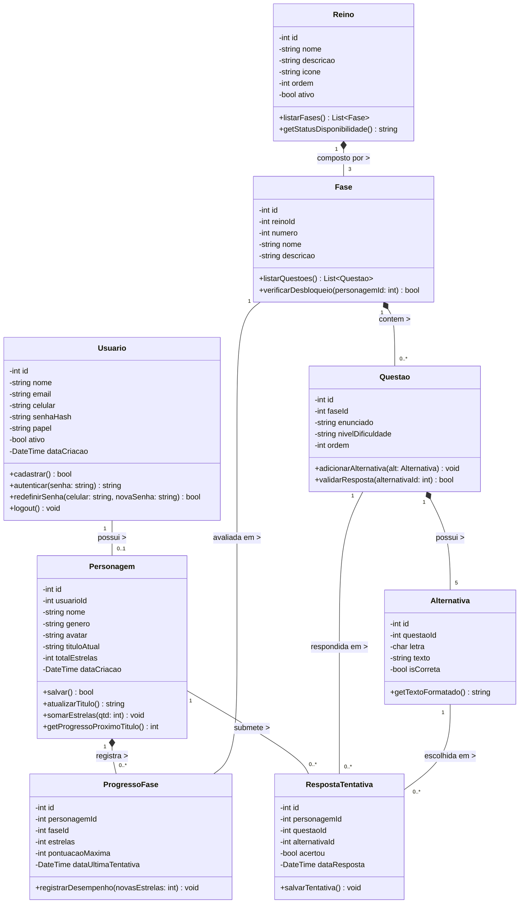

# 🏛️ Diagrama de Classes (UML) — Sistema Tronus

**Projeto Integrado Multidisciplinar (PIM III) — UNIP 2026**  
**Curso:** Superior de Tecnologia em Análise e Desenvolvimento de Sistemas (ADS)  
**Disciplina de Referência:** Programação Orientada a Objetos / Engenharia de Software Ágil Aplicada  
**Ferramenta CASE Oficial:** Astah UML  
**Arquivos Modelados (`.asta` e `.astah`):**
- `docs/DiagramasDeClasses.asta` / `docs/DiagramasDeClasses.astah`
- `docs/Engenharia de software ágil aplicada.asta` (Pacote `02_DiagramasDeClasses`)

---

## 📌 Sumário

1. [Visão Geral e Metodologia](#1-visão-geral-e-metodologia)
2. [DC01 — Diagrama de Classes de Domínio (Entidades de Negócio)](#2-dc01--diagrama-de-classes-de-domínio-entidades-de-negócio)
3. [Dicionário de Classes do Domínio](#3-dicionário-de-classes-do-domínio)
4. [Relacionamentos e Multiplicidades](#4-relacionamentos-e-multiplicidades)
5. [DC02 — Diagrama de Classes da Arquitetura Tronus Desktop (.NET 10 / C#)](#5-dc02--diagrama-de-classes-da-arquitetura-tronus-desktop-net-10--c)
6. [Dicionário de Componentes da Aplicação Desktop](#6-dicionário-de-componentes-da-aplicação-desktop)

---

## 1. Visão Geral e Metodologia

O **Diagrama de Classes** modela a estrutura estática do sistema **Tronus**, especificando as entidades de domínio, seus atributos encapsulados (`private`), operações públicas (`public`) e as relações de associação, composição e herança entre as camadas.

A modelagem está dividida em duas visões complementares:
1. **`DC01 - Diagrama de Classes de Dominio`**: Representa as 8 entidades fundamentais de negócio e persistência relacional (`Usuario`, `Personagem`, `Reino`, `Fase`, `Questao`, `Alternativa`, `ProgressoFase` e `RespostaTentativa`).
2. **`DC02 - Arquitetura Tronus Desktop`**: Representa a estrutura orientada a objetos do cliente desktop em C# (.NET 10 Windows Forms), abrangendo o orquestrador `MainForm`, os serviços (`ApiService`, `SessionManager`, `OfflineDataService`), o motor gráfico e de acessibilidade (`Theme`, `ControlesVisuaisGDI`) e as 12 telas (`UserControls`).

---

## 2. DC01 — Diagrama de Classes de Domínio (Entidades de Negócio)

### 2.1 Imagem Exportada do Astah UML (`DC01`)

### 2.2 Especificação Estrutural (Mermaid UML)

---

## 3. Dicionário de Classes do Domínio

| Classe | Responsabilidade no Domínio | Atributos Principais | Métodos Principais |
| :--- | :--- | :--- | :--- |
| **`Usuario`** | Conta institucional de acesso (aluno, professor ou administrador) com controle RBAC. | `id`, `nome`, `email`, `celular`, `senhaHash`, `papel`, `ativo`, `dataCriacao` | `cadastrar()`, `autenticar()`, `redefinirSenha()`, `logout()` |
| **`Personagem`** | Alter-ego medieval do estudante que acumula estrelas e evolui de patente nobiliárquica. | `id`, `usuarioId`, `nome`, `genero`, `avatar`, `tituloAtual`, `totalEstrelas` | `salvar()`, `atualizarTitulo()`, `somarEstrelas()`, `getProgressoProximoTitulo()` |
| **`Reino`** | Disciplina acadêmica do curso (Python, C++, Eng. Software, Banco de Dados, Redes). | `id`, `nome`, `descricao`, `icone`, `ordem`, `ativo` | `listarFases()`, `getStatusDisponibilidade()` |
| **`Fase`** | Etapa pedagógica progressiva (1: Fundamentos, 2: Aprofundamento, 3: Desafio Mestre). | `id`, `reinoId`, `numero`, `nome`, `descricao` | `listarQuestoes()`, `verificarDesbloqueio()` |
| **`Questao`** | Item avaliativo no padrão ENADE vinculado a uma fase específica. | `id`, `faseId`, `enunciado`, `nivelDificuldade`, `ordem` | `adicionarAlternativa()`, `validarResposta()` |
| **`Alternativa`** | Opção de resposta vinculada a uma questão, contendo indicador de gabarito. | `id`, `questaoId`, `letra`, `texto`, `isCorreta` | `getTextoFormatado()` |
| **`ProgressoFase`** | Histórico da melhor pontuação (`GREATEST`) e estrelas (0 a 3★) do herói por fase. | `id`, `personagemId`, `faseId`, `estrelas`, `pontuacaoMaxima`, `dataUltimaTentativa` | `registrarDesempenho()` |
| **`RespostaTentativa`** | Registro de auditoria das submissões de respostas de cada questão pelo estudante. | `id`, `personagemId`, `questaoId`, `alternativaId`, `acertou`, `dataResposta` | `salvarTentativa()` |

---

## 4. Relacionamentos e Multiplicidades

| Origem | Destino | Tipo de Relação | Multiplicidade | Regra Semântica |
| :--- | :--- | :---: | :---: | :--- |
| **`Usuario`** | **`Personagem`** | Associação | `1` para `0..1` | Cada estudante possui um único herói acadêmico; docentes e admins atuam sem herói. |
| **`Personagem`** | **`ProgressoFase`** | Composição (`*--`) | `1` para `0..*` | O histórico de fases pertence exclusivamente ao personagem. |
| **`Personagem`** | **`RespostaTentativa`** | Associação | `1` para `0..*` | O herói submete tentativas de resposta ao longo dos quizzes. |
| **`Reino`** | **`Fase`** | Composição (`*--`) | `1` para `3` | Cada reino curricular é estruturado em 3 fases sequenciais. |
| **`Fase`** | **`Questao`** | Composição (`*--`) | `1` para `0..*` | As questões compõem o acervo avaliativo de sua respectiva fase. |
| **`Fase`** | **`ProgressoFase`** | Associação | `1` para `0..*` | Uma fase registra o desempenho alcançado por múltiplos personagens. |
| **`Questao`** | **`Alternativa`** | Composição (`*--`) | `1` para `5` | Cada questão possui suas alternativas de múltipla escolha dependentes. |
| **`Questao`** | **`RespostaTentativa`** | Associação | `1` para `0..*` | Cada tentativa referencia a questão respondida. |
| **`Alternativa`** | **`RespostaTentativa`** | Associação | `1` para `0..*` | Cada tentativa referencia a alternativa assinalada pelo aluno. |

---

## 5. DC02 — Diagrama de Classes da Arquitetura Tronus Desktop (.NET 10 / C#)

### 5.1 Imagem Exportada do Astah UML (`DC02`)

### 5.2 Especificação Arquitetural Desktop (Mermaid UML)

```mermaid
classDiagram
    direction TB

    class MainForm {
        <<Form>>
        -Panel topBar
        -Panel contentPanel
        -Button btnSetup
        -Button btnModeBadge
        -AccessibilityThemeButton btnThemeToggle
        -UserControl _currentControl
        +LoadControl(uc: UserControl) void
        +AbrirMenuSetup() void
        +ApplyFontScale() void
        +ApplyTheme() void
        +UpdateBadgeState() void
    }

    class ApiService {
        <<Singleton>>
        -HttpClient _httpClient
        -static ApiService _instance
        +bool IsOfflineMode
        +GetAsync~T~(endpoint: string) Task~T~
        +PostAsync~TReq, TRes~(endpoint: string, data: TReq) Task~TRes~
        +PutAsync~TReq, TRes~(endpoint: string, data: TReq) Task~TRes~
        +DeleteAsync(endpoint: string) Task
    }

    class SessionManager {
        <<Static>>
        +static string AccessToken
        +static UsuarioDto CurrentUser
        +static PersonagemDto CachedHero
        +static bool IsLoggedIn
        +static Login(auth: AuthResponse, senha: string) void
        +static UpdateUserProfile(nome: string, email: string, celular: string, hero: PersonagemDto) void
        +static Logout() void
    }

    class OfflineDataService {
        <<Static>>
        +static PersonagemDto CurrentHero
        +static List~ProgressoFaseDto~ Progresso
        +static List~UsuarioDto~ UsuariosSistema
        +static HandleGet(endpoint: string) object
        +static HandlePost(endpoint: string, body: object) object
        +static AtualizarPerfilCompleto(req: AtualizarPerfilRequest) PersonagemDto
        +static AlterarSenhaUsuario(senhaAtual: string, novaSenha: string, out msg: string) bool
        +static RegistrarOuAtualizarUsuario(novo: UsuarioDto) void
        +static RemoverUsuario(id: int) bool
    }

    class Theme {
        <<Static>>
        +static bool IsDarkMode
        +static float FontScale
        +static Color Background
        +static Color Gold
        +static Color PrimaryText
        +static ToggleTheme() void
        +static IncreaseFontSize() bool
        +static DecreaseFontSize() bool
        +static ResetFontSize() void
        +static ApplyFontScaleToControl(root: Control) void
    }

    class ControlesVisuaisGDI {
        <<UI Kit>>
        +TronusButton
        +TronusPanel
        +AccessibilityThemeButton
        +PasswordToggleButton
        #OnPaint(e: PaintEventArgs) void
    }

    class UserControlBase {
        <<Windows Forms>>
        +bool DoubleBuffered
        +EnableDoubleBuffering(ctrl: Control) void
    }

    class ViewsAutenticacao {
        +UcLanding
        +UcLogin
        +UcRegister
        +UcForgotPassword
    }

    class ViewsJornadaAluno {
        +UcCharacter
        +UcReinos
        +UcPerfilAluno
        +UcQuiz
        +UcDashboard
        +UcRanking
    }

    class ViewsGestaoEQA {
        +UcProfessor
        +UcAdmin
        +UcTestRunner
    }

    MainForm --> UserControlBase : hospeda via LoadControl >
    MainForm --> SessionManager : valida sessao >
    MainForm --> ApiService : consome >
    MainForm *-- ControlesVisuaisGDI : compoe TopBar >
    ApiService --> OfflineDataService : fallback em memoria >
    ControlesVisuaisGDI --> Theme : aplica cores e escala >
    UserControlBase <|-- ViewsAutenticacao
    UserControlBase <|-- ViewsJornadaAluno
    UserControlBase <|-- ViewsGestaoEQA
```

---

## 6. Dicionário de Componentes da Aplicação Desktop

| Camada / Classe | Papel Arquitetural | Componentes Integrados |
| :--- | :--- | :--- |
| **`MainForm`** | Janela principal sem bordas nativas (*borderless*), com composição gráfica anti-flicker (`WS_EX_COMPOSITED`), TopBar global e botão **`⚙️ Setup`**. | `LoadControl()`, `AbrirMenuSetup()`, `ApplyFontScale()`, `ApplyTheme()` |
| **`ApiService`** | Cliente HTTP Singleton com autenticação `Bearer JWT` e chaveamento automático para modo offline em caso de indisponibilidade de rede. | `GetAsync()`, `PostAsync()`, `PutAsync()`, `DeleteAsync()`, `IsOfflineMode` |
| **`OfflineDataService`** | Banco de dados relacional em memória RAM com 5 Reinos, 15 Fases, acervo de questões, 18 cadastros ativos e gestão de perfil/senha. | `HandleGet()`, `HandlePost()`, `AtualizarPerfilCompleto()`, `AlterarSenhaUsuario()`, `RegistrarOuAtualizarUsuario()`, `RemoverUsuario()` |
| **`SessionManager`** | Gerenciador estático de estado de autenticação do cliente, preservando o usuário logado, senha e seu herói ativo. | `AccessToken`, `CurrentUser`, `CachedHero`, `Login()`, `UpdateUserProfile()`, `Logout()` |
| **`Theme` & `ControlesVisuaisGDI`** | Motor visual WCAG AAA com alternância instantânea entre tema *Dark Fantasy* e *Parchment Claro*, além de acessibilidade de fonte (`85%` a `145%`). | `TronusButton`, `TronusPanel`, `AccessibilityThemeButton`, `PasswordToggleButton` |
| **`ViewsAutenticacao`** | Telas de entrada, autenticação, registro cadastral e recuperação de senha em 3 etapas. | `UcLanding`, `UcLogin`, `UcRegister`, `UcForgotPassword` |
| **`ViewsJornadaAluno`** | Telas da experiência gamificada do estudante: criação de avatar, mapa curricular, edição de perfil/avatar/senha (`⚙️ Meu Perfil`), arena de quiz, dashboard e quadro de honra. | `UcCharacter`, `UcReinos`, `UcPerfilAluno`, `UcQuiz`, `UcDashboard`, `UcRanking` |
| **`ViewsGestaoEQA`** | Telas de gestão docente, governança administrativa (RBAC) e suíte automatizada de testes de software e rede (CT-01 a CT-16). | `UcProfessor`, `UcAdmin`, `UcTestRunner` |
