# 🔄 Diagramas de Sequência (UML) — Sistema Tronus

**Projeto Integrado Multidisciplinar (PIM III) — UNIP 2026**  
**Curso:** Superior de Tecnologia em Análise e Desenvolvimento de Sistemas (ADS)  
**Disciplina de Referência:** Análise e Modelagem de Sistemas / Engenharia de Software Ágil Aplicada  
**Ferramenta CASE Oficial:** Astah UML  
**Arquivos Modelados (`.asta` e `.astah`):**
- `docs/DiagramasDeSequencia.asta` / `docs/DiagramasDeSequencia.astah`
- `docs/Engenharia de software ágil aplicada.asta` (Pacote `04_DiagramasDeSequencia`)

---

## 📌 Sumário

1. [Visão Geral e Fundamentação Teórica](#1-visão-geral-e-fundamentação-teórica)
2. [Arquitetura em Camadas do Tronus (Desktop & Web)](#2-arquitetura-em-camadas-do-tronus-desktop--web)
3. [Dicionário de Linhas de Vida (Lifelines) e Participantes](#3-dicionário-de-linhas-de-vida-lifelines-e-participantes)
4. [Matriz de Correspondência entre Telas e Diagramas](#4-matriz-de-correspondência-entre-telas-e-diagramas)
5. [Diagramas de Sequência Detalhados por Tela (DS01 a DS11)](#5-diagramas-de-sequência-detalhados-por-tela-ds01-a-ds11)
   - [5.1 DS01 — Apresentação e Boas-Vindas (`UcLanding`)](#51-ds01--apresentação-e-boas-vindas-uclanding)
   - [5.2 DS02 — Autenticação e Login (`UcLogin`)](#52-ds02--autenticação-e-login-uclogin)
   - [5.3 DS03 — Cadastro de Estudante (`UcRegister`)](#53-ds03--cadastro-de-estudante-ucregister)
   - [5.4 DS04 — Recuperação de Senha (`UcForgotPassword`)](#54-ds04--recuperação-de-senha-ucforgotpassword)
   - [5.5 DS05 — Forja e Criação do Herói (`UcCharacter`)](#55-ds05--forja-e-criação-do-herói-uccharacter)
   - [5.6 DS06 — Mapa dos Reinos e Seleção de Fases (`UcReinos`)](#56-ds06--mapa-dos-reinos-e-seleção-de-fases-ucreinos)
   - [5.7 DS07 — Desafio e Quiz Gamificado (`UcQuiz`)](#57-ds07--desafio-e-quiz-gamificado-ucquiz)
   - [5.8 DS08 — Painel de Desempenho e Dashboard (`UcDashboard`)](#58-ds08--painel-de-desempenho-e-dashboard-ucdashboard)
   - [5.9 DS09 — Quadro de Honra e Ranking (`UcRanking`)](#59-ds09--quadro-de-honra-e-ranking-ucranking)
   - [5.10 DS10 — Painel Pedagógico do Professor (`UcProfessor`)](#510-ds10--painel-pedagógico-do-professor-ucprofessor)
   - [5.11 DS11 — Painel de Governança do Administrador (`UcAdmin`)](#511-ds11--painel-de-governança-do-administrador-ucadmin)
6. [Matriz de Rastreabilidade (Casos de Uso vs. Telas vs. Diagramas)](#6-matriz-de-rastreabilidade-casos-de-uso-vs-telas-vs-diagramas)

---

## 1. Visão Geral e Fundamentação Teórica

O **Diagrama de Sequência** modela a **dinâmica temporal** do sistema **Tronus**, ilustrando a ordem cronológica em que atores, telas (`UserControls`), serviços (`ApiService`, `SessionManager`), controladores de API e o banco de dados relacional (`PostgreSQL_Tronus`) trocam mensagens síncronas, assíncronas e de retorno.

---

## 2. Arquitetura em Camadas do Tronus (Desktop & Web)

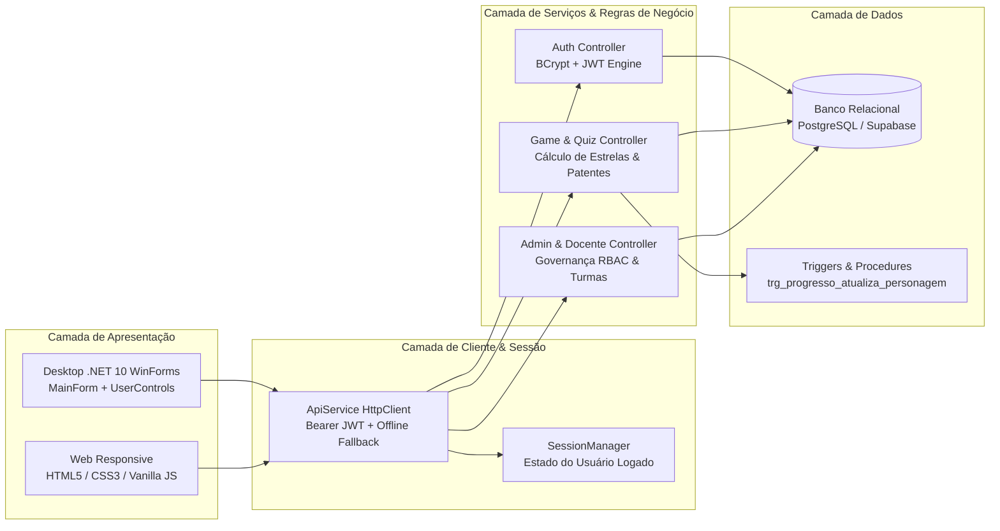

---

## 3. Dicionário de Linhas de Vida (Lifelines) e Participantes

| Linha de Vida (Lifeline) | Tipo UML | Descrição e Responsabilidade |
| :--- | :---: | :--- |
| **`Ator (Estudante / Professor / Admin)`** | Ator Humano | Usuário que dispara os eventos por clique, digitação ou seleção em tela. |
| **`UI: UserControl`** | View / Fronteira | Controle visual (`UcLogin`, `UcQuiz`, `UcAdmin`, etc.) responsável por capturar eventos, validar entradas e renderizar dados. |
| **`MF: MainForm`** | Controller de Janela | Formulário principal do C# Desktop que hospeda os `UserControls` dinamicamente no `contentPanel` via `LoadControl(uc)`. |
| **`API: ApiService`** | Client Service | Singleton HTTP que serializa DTOs em JSON, anexa `Authorization: Bearer <token>` e gerencia chamadas ou fallback para `OfflineDataService`. |
| **`SM: SessionManager`** | State Manager | Gerenciador estático em memória que armazena a sessão ativa (`CurrentUser`, `AccessToken`, `CurrentHero`). |
| **`SRV: BackendAPI`** | Controller REST | API que processa requisições REST, aplica hashing BCrypt, valida permissões RBAC e responde em JSON. |
| **`DB: PostgreSQL_Tronus`** | Persistência Relacional | Banco de dados relacional PostgreSQL (Supabase) que executa consultas e transações com integridade referencial. |
| **`TRG: TriggerPatentes`** | Automação no Banco | Gatilho de banco (`trg_progresso_atualiza_personagem`) que recalcula `total_estrelas` e promove a patente nobiliárquica do herói. |

---

## 4. Matriz de Correspondência entre Telas e Diagramas

| # | Nome da Tela | Componente Desktop (C#) | Arquivo Web | Papel de Acesso | Diagrama Astah |
| :-: | :--- | :--- | :--- | :---: | :--- |
| **01** | Apresentação / Boas-Vindas | `UcLanding.cs` | `index.html` | Público / Todos | `DS01 - Tela Landing (UcLanding)` |
| **02** | Autenticação / Login | `UcLogin.cs` | `login.html` | Público | `DS02 - Tela Login (UcLogin)` |
| **03** | Cadastro de Estudante | `UcRegister.cs` | `register.html` | Público | `DS03 - Tela Cadastro (UcRegister)` |
| **04** | Recuperação de Senha (SMS) | `UcForgotPassword.cs` | `forgot_password.html` | Público | `DS04 - Recuperar Senha (UcForgotPassword)` |
| **05** | Forja do Herói (Personagem) | `UcCharacter.cs` | `character.html` | Aluno (Sem Herói) | `DS05 - Forja do Heroi (UcCharacter)` |
| **06** | Mapa dos Reinos e Fases | `UcReinos.cs` | `reinos.html` / `trilha.html` | Aluno | `DS06 - Selecao de Reinos (UcReinos)` |
| **07** | Desafio e Resolução de Quiz | `UcQuiz.cs` | `trilha.html` (Quiz) | Aluno | `DS07 - Desafio e Quiz (UcQuiz)` |
| **08** | Painel do Aluno / Dashboard | `UcDashboard.cs` | `dashboard.html` | Aluno | `DS08 - Dashboard do Aluno (UcDashboard)` |
| **09** | Quadro de Honra / Ranking | `UcRanking.cs` | Ranking Interativo | Aluno / Docente | `DS09 - Ranking Academico (UcRanking)` |
| **10** | Painel Pedagógico do Professor | `UcProfessor.cs` | `professor.html` | Professor | `DS10 - Painel do Professor (UcProfessor)` |
| **11** | Painel de Governança Admin | `UcAdmin.cs` | `admin.html` | Administrador | `DS11 - Painel do Administrador (UcAdmin)` |

---

## 5. Diagramas de Sequência Detalhados por Tela (DS01 a DS11)

---

### 5.1 DS01 — Apresentação e Boas-Vindas (`UcLanding`)

.png)

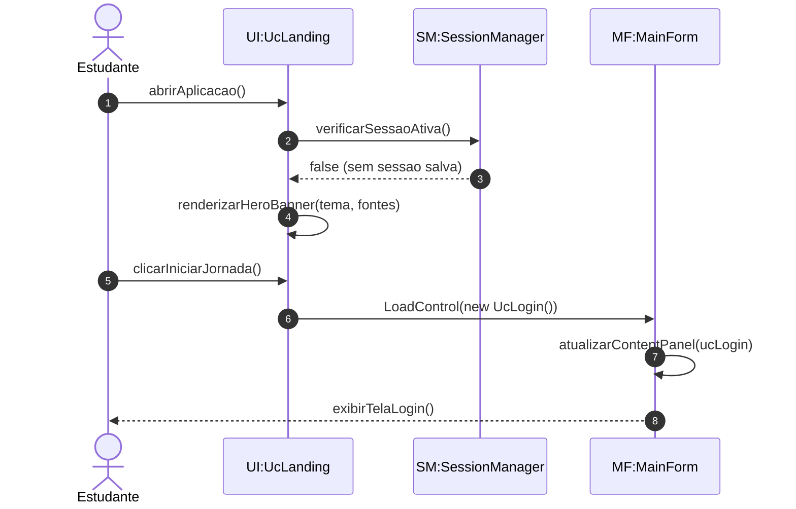

---

### 5.2 DS02 — Autenticação e Login (`UcLogin`)

.png)

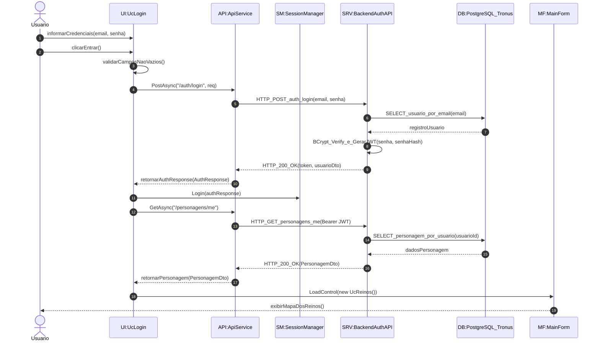

---

### 5.3 DS03 — Cadastro de Estudante (`UcRegister`)

.png)

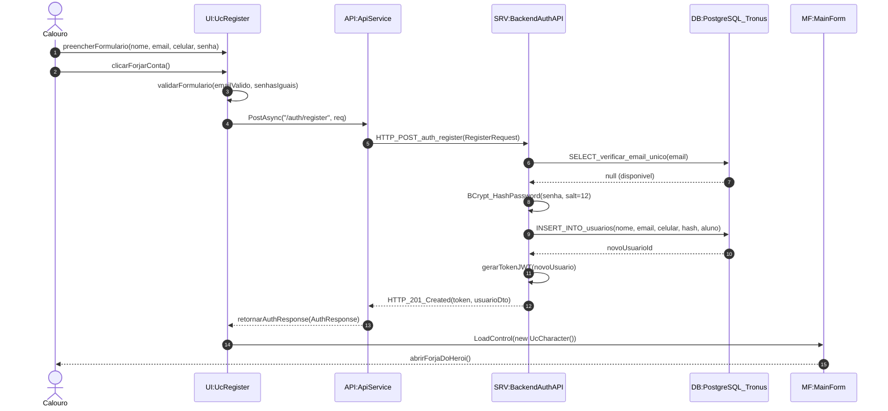

---

### 5.4 DS04 — Recuperação de Senha (`UcForgotPassword`)

.png)

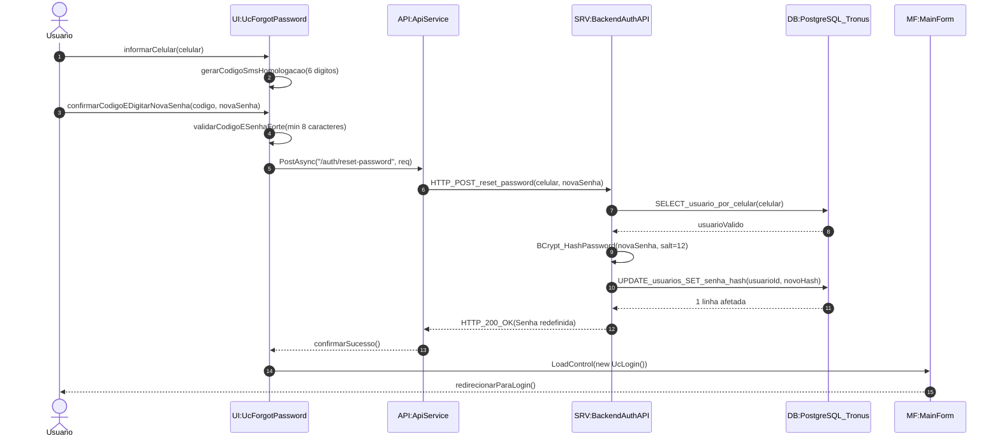

---

### 5.5 DS05 — Forja e Criação do Herói (`UcCharacter`)

.png)

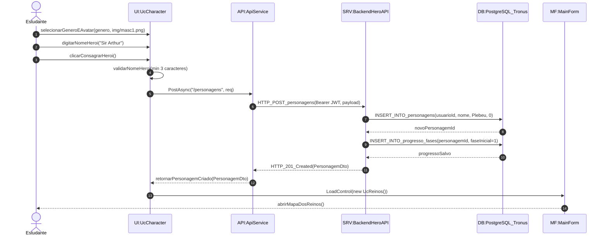

---

### 5.6 DS06 — Mapa dos Reinos e Seleção de Fases (`UcReinos`)

.png)

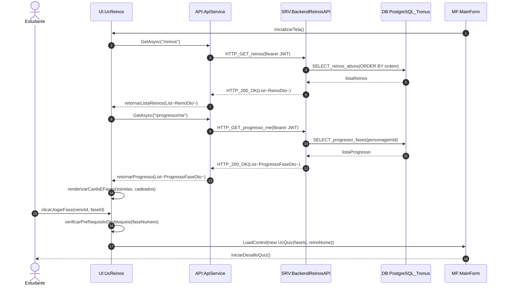

---

### 5.7 DS07 — Desafio e Quiz Gamificado (`UcQuiz`)

.png)

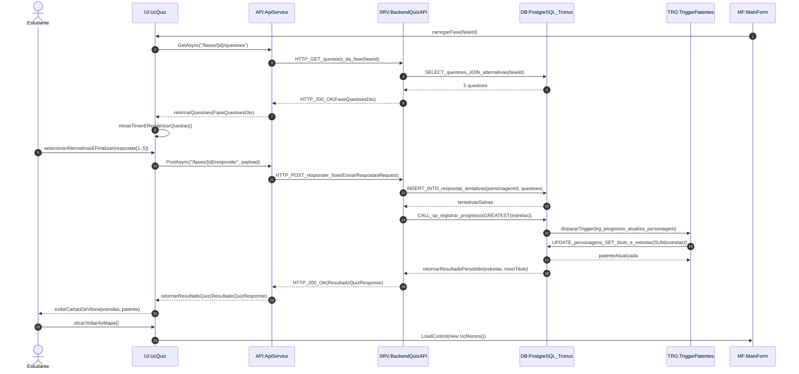

---

### 5.8 DS08 — Painel de Desempenho e Dashboard (`UcDashboard`)

.png)

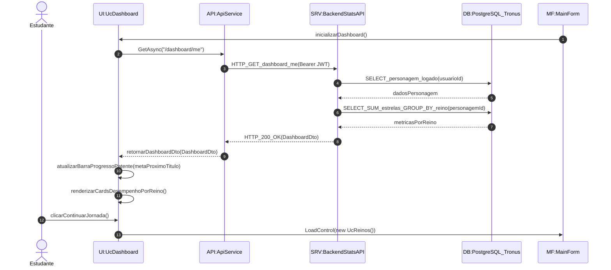

---

### 5.9 DS09 — Quadro de Honra e Ranking (`UcRanking`)

.png)

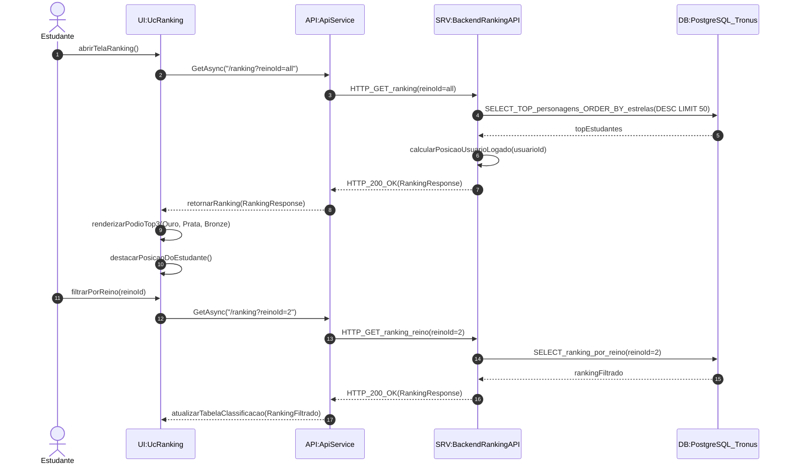

---

### 5.10 DS10 — Painel Pedagógico do Professor (`UcProfessor`)

.png)

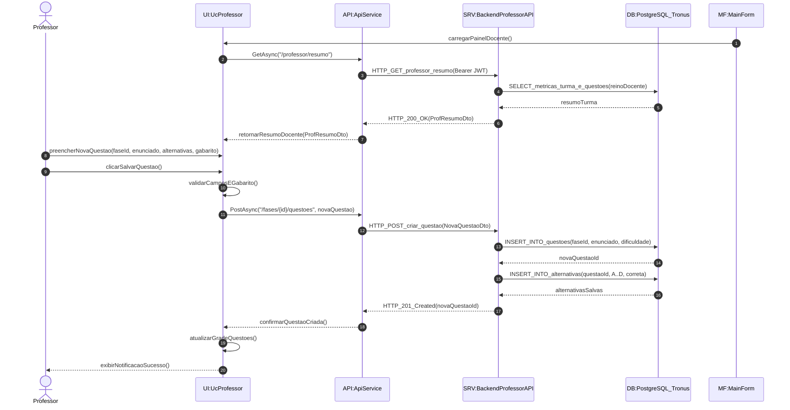

---

### 5.11 DS11 — Painel de Governança do Administrador (`UcAdmin`)

.png)

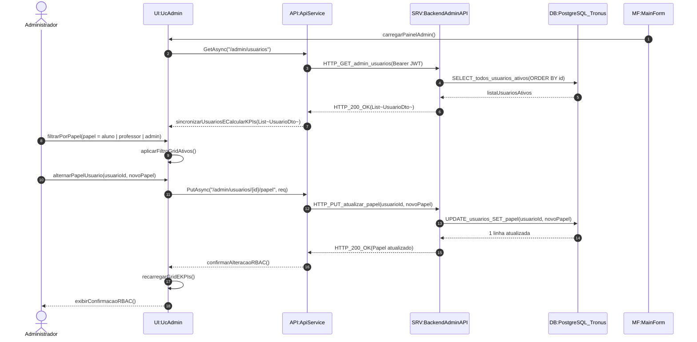

---

## 6. Matriz de Rastreabilidade (Casos de Uso vs. Telas vs. Diagramas)

| Caso de Uso do Sistema | Tela Responsável | Diagrama de Sequência Astah | Entidades de Banco Impactadas |
| :--- | :--- | :--- | :--- |
| **UC01: Efetuar Cadastro** | `UcRegister` (`register.html`) | `DS03 - Tela Cadastro (UcRegister)` | `usuarios` |
| **UC02: Efetuar Login** | `UcLogin` (`login.html`) | `DS02 - Tela Login (UcLogin)` | `usuarios`, `personagens` |
| **UC03: Recuperar Senha** | `UcForgotPassword` (`forgot_password.html`) | `DS04 - Recuperar Senha (UcForgotPassword)` | `usuarios` |
| **UC04: Forjar Personagem** | `UcCharacter` (`character.html`) | `DS05 - Forja do Heroi (UcCharacter)` | `personagens`, `progresso_fases` |
| **UC05: Explorar Mapa dos Reinos** | `UcReinos` (`reinos.html`) | `DS06 - Selecao de Reinos (UcReinos)` | `reinos`, `fases`, `progresso_fases` |
| **UC06 / UC07: Responder e Pontuar Quiz** | `UcQuiz` | `DS07 - Desafio e Quiz (UcQuiz)` | `questoes`, `alternativas`, `respostas_tentativas`, `progresso_fases` |
| **UC08 / UC09: Desbloquear Fase e Promover Título** | `UcReinos` & `UcQuiz` (Trigger) | `DS06` e `DS07` | `personagens`, `trg_progresso_atualiza_personagem` |
| **UC10: Visualizar Desempenho** | `UcDashboard` (`dashboard.html`) | `DS08 - Dashboard do Aluno (UcDashboard)` | `personagens`, `progresso_fases`, `reinos` |
| **UC11: Acompanhar Classificação** | `UcRanking` | `DS09 - Ranking Academico (UcRanking)` | `personagens`, `usuarios` |
| **UC12: Gestão Pedagógica Docente** | `UcProfessor` (`professor.html`) | `DS10 - Painel do Professor (UcProfessor)` | `questoes`, `alternativas`, `fases` |
| **UC13: Governança Administrativa** | `UcAdmin` (`admin.html`) | `DS11 - Painel do Administrador (UcAdmin)` | `usuarios`, `reinos` |
