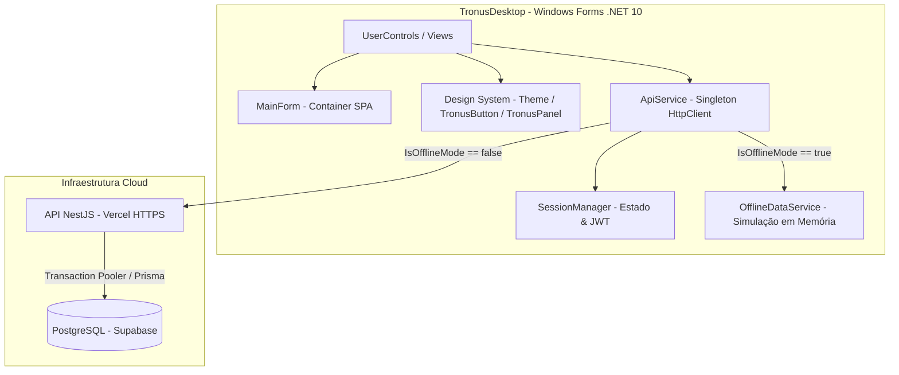
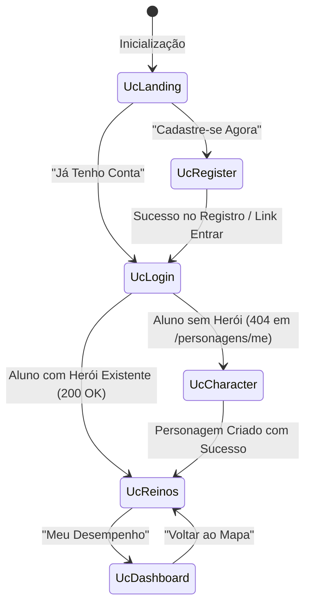

# ⚔️ TronusDesktop — Cliente Windows (.NET 10 / Windows Forms)

Aplicação desktop oficial da plataforma gamificada **Tronus**, desenvolvida em **C#** sobre o ecossistema **.NET 10 (Windows Forms)**. O cliente desktop foi concebido no modelo **Thin Client (Cliente Leve)**, integrando-se via HTTP/REST à API central na nuvem (`https://king-blue-nine.vercel.app`) conectada ao banco de dados relacional **PostgreSQL (Supabase)**.

---

## 📌 Sumário

1. [Documentação e Artefatos do Projeto](#-documentação-e-artefatos-do-projeto)
2. [Visão Geral & Arquitetura](#-visão-geral--arquitetura)
3. [Estrutura do Projeto](#-estrutura-do-projeto)
4. [Design System & Identidade Visual](#-design-system--identidade-visual)
5. [Camada de Serviços & Comunicação HTTP](#-camada-de-serviços--comunicação-http)
6. [Telas & Fluxo de Navegação (Views)](#-telas--fluxo-de-navegação-views)
7. [Modelos de Dados (DTOs)](#-modelos-de-dados-dtos)
8. [Pré-requisitos & Como Executar](#-pré-requisitos--como-executar)
9. [Roteiro de Testes e Validação](#-roteiro-de-testes-e-validação)
10. [Credenciais de Homologação](#-credenciais-de-homologação)
11. [Modo Offline (Demonstração Resiliente para Banca)](#-modo-offline-demonstração-resiliente-para-banca)

---

## 📚 Documentação e Artefatos do Projeto

Abaixo estão os links de acesso direto aos artefatos de modelagem, arquitetura e documentação técnica da aplicação desktop:

| Artefato / Documento | Link de Acesso | Descrição e Finalidade Acadêmica |
| :--- | :---: | :--- |
| 📖 **Documentação do Software** | [**`SoftwareDocument.md`**](SoftwareDocument.md) | Especificação técnica completa da aplicação desktop: arquitetura Thin Client, consumo de APIs, modelos de dados, componentes visuais, tratamento de erros e ciclo de vida. |
| 🏛️ **Diagrama de Classes (UML)** | [**`DiagramaDeClasses.md`**](DiagramaDeClasses.md) | Modelagem estática do domínio com entidades, DTOs, métodos, atributos, relacionamentos em Mermaid e tutorial passo a passo para o software **Astah UML**. |
| 📐 **Diagrama de Casos de Uso (UML)** | [**`DiagramaDeCasosDeUso.md`**](DiagramaDeCasosDeUso.md) | Modelagem funcional com atores (Aluno, Professor, Administrador, Sistema), diagramas por pacote, dependências (`<<include>>`/`<<extend>>`) e matriz de rastreabilidade dos requisitos (RF01 a RF15). |
| 🔄 **Diagramas de Sequência (UML)** | [**`DiagramaDeSequencia.md`**](DiagramaDeSequencia.md) | Modelagem comportamental e dinâmica com 11 diagramas de sequência cobrindo todas as telas, lifelines, tabelas de mensagens, regras de negócio e arquivos **Astah UML (`.asta` e `.astah`)**. |
| 🔀 **Diagrama de Atividades (UML)** | [**`DiagramaDeAtividades.md`**](DiagramaDeAtividades.md) | Modelagem procedural dos fluxos de trabalho (DA01 a DA06), raias operacionais e arquivos **Astah UML (`DiagramasDeAtividade.asta` e `.astah`)**. |
| 📘 **Manual do Usuário** | [**`ManualDoUsuario.md`**](ManualDoUsuario.md) | Guia ilustrado passo a passo para o usuário final em 12 capítulos, cobrindo instalação, atalhos, navegação por todas as telas e solução de dúvidas frequentes. |
| 📊 **Apresentação Executiva (PPTX)** | [**`Apresentacao_Tronus_UML.pptx`**](Apresentacao_Tronus_UML.pptx) | Slides 16:9 widescreen para defesa acadêmica na UNIP com todos os diagramas de Casos de Uso, Atividades (DA01 a DA06) e Sequência (DS01 a DS11). |

---

## 🏛️ Visão Geral & Arquitetura

O **TronusDesktop** opera como um cliente desacoplado da persistência física de dados. Em vez de abrir conexões diretas via driver de banco de dados (o que exporia credenciais e contornaria regras de negócio e RLS), o sistema segue rigorosamente a arquitetura em camadas:



### Princípios Arquiteturais:
* **Single Page Application (SPA) Desktop:** O formulário principal (`MainForm`) atua como container fixo (1024×768), sem recriar formulários. A navegação entre telas é realizada dinamicamente alternando instâncias de `UserControl` no painel central via método `LoadControl(UserControl uc)`.
* **Zero Client Calculation:** Regras de negócio como progressão de títulos (Plebeu → Cavaleiro → Duque → Rei), cálculo de estrelas e taxa de acerto são calculadas centralmente pelo banco e API. O cliente desktop consome e exibe essas informações de forma reativa.
* **Segurança e Sessão Stateless:** Autenticação baseada em tokens JWT. Ao efetuar login, o token é injetado automaticamente nos headers de todas as chamadas protegidas (`Authorization: Bearer <token>`). Se a API retornar `401 Unauthorized`, a sessão é invalidada e o usuário é redirecionado para a tela de autenticação.

### 🌐 Portas de Rede e Comunicação com a API:
A aplicação desktop consome os serviços da API REST na nuvem através das seguintes portas padronizadas:

| Porta | Protocolo | Origem | Destino | Função Principal |
|:---:|:---:|:---:|:---:|---|
| **443** | **HTTPS (TLS 1.2 / 1.3)** | Tronus Desktop | `king-blue-nine.vercel.app` | **Porta Principal de Produção:** Envio criptografado de credenciais, progresso dos reinos, envio de gabaritos e sincronização de dados via Web segura. |
| **3000** | **HTTP** | Tronus Desktop / Web | `localhost:3000` | **Porta de Homologação Local:** Utilizada para testes locais da API NestJS sem necessidade de deploy. |
| **5500** | **HTTP** | Navegador Web | `127.0.0.1:5500` | **Porta de Apoio Web:** Live Server do VS Code para os arquivos estáticos HTML5/CSS3. |

> 🔒 **Requisito de Rede:** Para o pleno funcionamento do Tronus Desktop, a rede local (incluindo laboratórios de faculdade da UNIP ou firewalls corporativos) precisa permitir tráfego de saída **TCP na porta 443**.

---

## 📂 Estrutura do Projeto

```
TronusDesktop/
├── Apresentacao_Tronus_UML.pptx # Apresentação em slides 16:9 para a Banca Examinadora
├── DiagramaDeCasosDeUso.md     # Modelagem de Casos de Uso e Matriz RF01-RF15
├── DiagramaDeClasses.md        # Modelagem de Classes e Guia Astah UML
├── DiagramaDeSequencia.md      # Modelagem Dinâmica dos 11 Diagramas de Sequência
├── DiagramaDeAtividades.md     # Modelagem Procedural de Atividades (DA01 a DA06)
├── DiagramasDeAtividade.asta   # Projeto Astah Oficial com os 6 Diagramas de Atividades
├── DiagramasDeAtividade.astah  # Cópia no formato .astah solicitada para entrega
├── DiagramasDeSequencia.asta   # Projeto Astah Oficial com os 11 Diagramas de Sequência
├── DiagramasDeSequencia.astah  # Cópia no formato .astah solicitada para entrega
├── ManualDoUsuario.md          # Manual de Instruções e Uso da Aplicação
├── SoftwareDocument.md         # Documentação de Arquitetura e Engenharia de Software
├── Models/                     # DTOs de envio e resposta da API
│   ├── ApiErrorResponse.cs     # Mapeamento de erros padronizados da API
│   ├── AuthModels.cs           # Login, Registro, Recuperação e Dados do Usuário
│   ├── DashboardModels.cs      # Estatísticas, KPIs e histórico de respostas
│   ├── PersonagemModels.cs     # Criação e perfil do herói
│   ├── QuizModels.cs           # Questões, alternativas e envio de gabarito
│   └── ReinoModels.cs          # Matérias/Reinos e progresso por fases
├── Services/                   # Comunicação e infraestrutura
│   ├── ApiException.cs         # Exceção customizada com códigos e mensagens da API
│   ├── ApiService.cs           # Singleton HTTP com injeção de JWT e roteamento offline
│   ├── OfflineDataService.cs   # Motor autônomo em memória para o Modo Offline / Demonstração
│   └── SessionManager.cs       # Armazenamento em memória da sessão e usuário logado
├── UI/                         # Componentes visuais personalizados
│   ├── Theme.cs                # Paleta dinâmica de cores, gradientes e gerenciador de acessibilidade
│   ├── TronusButton.cs         # Botão customizado com cantos arredondados e hover
│   ├── TronusPanel.cs          # Card medieval translúcido com borda dourada
│   ├── PasswordToggleButton.cs # Botão vetorial GDI+ para alternar visibilidade de senhas
│   └── AccessibilityThemeButton.cs # Botão de acessibilidade vetorial GDI+ presente em todas as telas (Modo Claro / Modo Escuro, atalhos Ctrl+T / Alt+A)
├── Views/                      # Telas (UserControls) do sistema
│   ├── UcLanding.cs            # Tela de boas-vindas / Hero
│   ├── UcLogin.cs              # Autenticação de usuários com roteamento por papel
│   ├── UcForgotPassword.cs     # Recuperação de senha em 3 etapas (SMS)
│   ├── UcRegister.cs           # Cadastro de novo estudante
│   ├── UcCharacter.cs          # Seleção de gênero e escolha de avatar
│   ├── UcReinos.cs             # Mapa dos 5 reinos e fases com HUD do herói
│   ├── UcQuiz.cs               # Desafios de combate com 5 questões pedagógicas
│   ├── UcDashboard.cs          # Painel analítico com KPIs, gráfico por reino e tabela
│   ├── UcRanking.cs            # Hall dos heróis com pódio e classificação geral
│   ├── UcProfessor.cs          # Portal do professor (questões e busca de alunos)
│   └── UcAdmin.cs              # Painel administrativo de governança global
├── MainForm.cs                 # Formulário principal sem bordas (Container SPA)
├── Program.cs                  # Ponto de entrada do executável Windows
└── TronusDesktop.csproj        # Configuração do projeto (.NET 10, Windows Forms)
```

---

## 🎨 Design System & Identidade Visual

O **TronusDesktop** foi construído para fugir da estética cinza padrão do Windows Forms tradicional, entregando uma atmosfera medieval estilizada e imersiva:

* **Janela Sem Bordas (Borderless):** `FormBorderStyle = FormBorderStyle.None` com barra superior personalizada (`TopBar`) arrastável e botão de fechar estilizado.
* **Paleta de Cores (`Theme.cs`):**
  * `Background`: `#1A1A1A` (Grafite escuro de alta legibilidade).
  * `CardBackground`: `rgba(0, 0, 0, 0.5)` (Efeito de vidro escuro / Glassmorphism translúcido).
  * `Gold`: `#D4AF37` (Dourado nobre para títulos, botões e estrelas).
  * `PrimaryText`: `#F0E6C8` (Creme/Pergaminho suave para leitura prolongada).
  * `DimText`: `#A89060` (Dourado ocre atenuado para labels auxiliares e subtítulos).
  * `ButtonPrimaryStart` & `End`: Gradiente verde-azulado medieval (`#1A6B4A` → `#1A4A6B`).
  * `BorderColor`: Borda com 30% de opacidade dourada (`rgba(212, 175, 55, 0.3)`).
* **Controles Customizados:**
  * `TronusButton`: Desenho vetorial via GDI+ com `LinearGradientBrush`, cantos curvos (`GraphicsPath`) e transição suave no cursor `Hand`.
  * `TronusPanel`: Cards com fundo escuro translúcido e bordas douradas finas para agrupamento de campos de formulário e cartas de reino.

---

## 🌐 Camada de Serviços & Comunicação HTTP

### `ApiService.cs`
A classe central de integração HTTP adota o padrão **Singleton** e consome endpoints com `System.Net.Http.Json`:

```csharp
// Exemplo de consumo no cliente
var reinos = await ApiService.Instance.GetAsync<List<ReinoDto>>("/reinos");
var resultado = await ApiService.Instance.PostAsync<LoginRequest, AuthResponse>("/auth/login", dados);
```

#### Recursos de Rede:
1. **URL Base Fixa:** `https://king-blue-nine.vercel.app`.
2. **Injeção de Cabeçalho:** Adiciona dinamicamente `Authorization: Bearer <token>` quando `SessionManager.IsLoggedIn` for verdadeiro.
3. **Tratamento de Exceções (`ApiException`):** Captura erros `400 Bad Request` com listas de mensagens de validação e deserializa o JSON para exibição amigável ao usuário.
4. **Intercepção de 401 Unauthorized:** Limpa a sessão expirada (tokens possuem validade de 1 hora) e força reautenticação.

---

## 🖥️ Telas & Fluxo de Navegação (Views)



1. **`UcLanding` (Boas-vindas):** Exibe banner hero com arte medieval, logotipo do Tronus, subtítulo épico e botões direcionando para cadastro ou autenticação.
2. **`UcLogin` (Autenticação):** Formulário compacto centralizado com validação de campos vazios, suporte a submissão via tecla `Enter` e verificação assíncrona da existência de herói cadastrado.
3. **`UcRegister` (Cadastro):** Validações em tempo real de e-mail, celular, nome de usuário e requisitos mínimos de senha (8+ caracteres, maiúsculas, minúsculas, números e símbolos).
4. **`UcCharacter` (Criação de Personagem):** Seleção de gênero (Masculino/Feminino) que carrega dinamicamente os avatares disponíveis (`masc1..3` e `fem1..3`). Permite batizar o herói e envia os dados para `POST /personagens`.
5. **`UcReinos` (Mapa de Reinos):** Carrega os 5 reinos e o progresso do aluno via API. Renderiza cards dinâmicos exibindo pontuação com estrelas preenchidas (`★`) e vazias (`☆`), habilitando o botão "Jogar" conforme a ordem de desbloqueio.
6. **`UcDashboard` (Dashboard de Desempenho):** Exibe resumo das conquistas, total de estrelas, título atual e taxas de rendimento por matéria.

---

## 📦 Modelos de Dados (DTOs)

| DTO | Finalidade | Campos Principais |
|---|---|---|
| `LoginRequest` | Envio de credenciais | `identificador`, `senha` |
| `RegisterRequest` | Cadastro de novos alunos | `nome`, `email`, `celular`, `senha` |
| `AuthResponse` | Retorno de autenticação | `accessToken`, `tokenType`, `expiresIn`, `usuario` |
| `UsuarioDto` | Perfil do usuário autenticado | `id`, `nome`, `email`, `papel` |
| `CriarPersonagemRequest` | Envio de criação do herói | `nome`, `genero`, `avatar` |
| `PersonagemDto` | Estado do herói | `id`, `nome`, `genero`, `avatar`, `tituloAtual`, `totalEstrelas` |
| `ReinoDto` | Lista de reinos | `id`, `nome`, `descricao` |
| `ProgressoFaseDto` | Progresso individual | `faseId`, `faseNome`, `ordem`, `estrelas`, `jogada` |
| `ApiErrorResponse` | Erros formatados da API | `statusCode`, `message` (string ou array), `error` |

---

## 🚀 Pré-requisitos & Como Executar

### Pré-requisitos:
* **SDK .NET 10.0** (ou superior) instalado na máquina.
* Sistema operacional **Windows 10 / 11**.
* Conexão ativa com a internet para integração com a API Vercel e banco Supabase.

### Executando pelo Terminal:
1. Abra o terminal na raiz do repositório:
```bash
dotnet run --project TronusDesktop/TronusDesktop.csproj
```

### Compilando para Release / Distribuição:
```bash
dotnet publish TronusDesktop/TronusDesktop.csproj -c Release -r win-x64 --self-contained false
```
O executável gerado e as dependências estarão disponíveis em:  
`TronusDesktop/bin/Release/net10.0-windows/win-x64/publish/TronusDesktop.exe`.

---

## 🧪 Roteiro de Testes e Validação

| ID | Cenário | Ação do Usuário | Resultado Esperado |
|---|---|---|---|
| **CT-Desk-01** | Tela Inicial e Redirecionamento | Iniciar o app e clicar em "JÁ TENHO CONTA" | Carrega a tela `UcLogin` centralizada com fundo medieval |
| **CT-Desk-02** | Login com Credenciais Inválidas | Inserir usuário `inexistente` e senha incorreta | Caixa de alerta exibindo erro retornado pela API (ex: 401 ou 404) |
| **CT-Desk-03** | Login com Aluno Existente | Inserir credenciais válidas com personagem criado | Redireciona para `UcReinos` com os cards dos reinos e estrelas |
| **CT-Desk-04** | Primeiro Login (Sem Herói) | Fazer login com conta recém-registrada | Redireciona automaticamente para `UcCharacter` |
| **CT-Desk-05** | Seleção de Avatar | Alternar gênero entre Masculino e Feminino | Galeria de avatares recarrega as imagens correspondentes |
| **CT-Desk-06** | Navegação ao Dashboard | Clicar em "Meu Desempenho" no mapa | Abre `UcDashboard` com botão "Voltar ao Mapa" funcional |

---

## 🔑 Credenciais de Homologação

Para testes da equipe e avaliação de bancas acadêmicas:

| Papel | Identificador / Usuário | Senha | Destino Padrão |
|---|---|---|---|
| **Administrador** | `admin` | `Tronus@adm1` | Painel Administrativo / API |
| **Professor (Python)** | `prof_python` | `Python@prof1` | Painel do Professor / API |
| **Aluno Homologação** | *(Criar via `UcRegister`)* | `Teste@123` | Criação de Herói → Reinos |

---

## ⚡ Modo Offline (Demonstração Resiliente para Banca)

Pensado estrategicamente para a defesa acadêmica perante a banca examinadora da UNIP, o Tronus Desktop dispõe de uma infraestrutura de **alta disponibilidade e tolerância a falhas locais**:

### 🎯 Como Acionar:
1. **Botão Dedicado no Login:** Na tela `UcLogin`, clique diretamente no botão dourado **`⚡ ENTRAR EM MODO OFFLINE (DEMO)`**. O sistema inicializará instantaneamente o perfil veterano de `Sir Arthur` com dados pré-carregados.
2. **Badge Interativo na TopBar:** A qualquer momento, clique no botão de status de rede no canto superior direito (`🟢 Online` ⇋ `⚡ Offline (Demo)`). A aplicação chaveará a fonte de dados em tempo de execução sem reiniciar o formulário.
3. **Fallback Automático de Queda de Rede:** Se a internet oscilar ou cair durante a tentativa de login online, um diálogo oferecerá alternância imediata para o Modo Offline local.

### 🛡️ O que está disponível no Modo Offline:
* **Autenticação Simulada:** Aluno (`Arthur Pendragon`), Professor (`Prof. Albus`) e Administrador (`Admin Morgana`).
* **Perfil do Herói:** `Sir Arthur`, Patente `Duque`, 38 estrelas acumuladas e avatar medieval `masc1`.
* **5 Reinos & 15 Fases Ativas:** *Python*, *C++*, *Banco de Dados*, *Redes* e *Engenharia de Software*.
* **Banco de Desafios Completo:** Quizzes pedagógicos com enunciados reais de Ciência da Computação, validação de gabarito e cálculo dinâmico de estrelas.
* **Dashboard Analítico:** KPIs de aproveitamento geral, histórico de acertos e gráficos por matéria.

---

<div align="center">
Desenvolvido com ⚔️ e dedicação pela equipe <b>TRONUS — UNIP</b>
</div>
